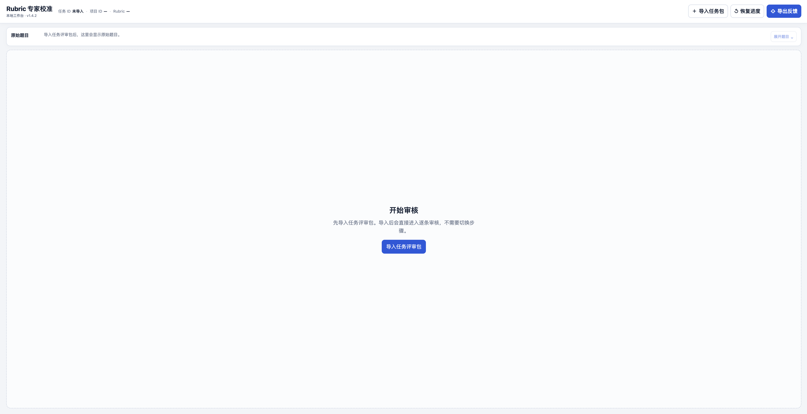
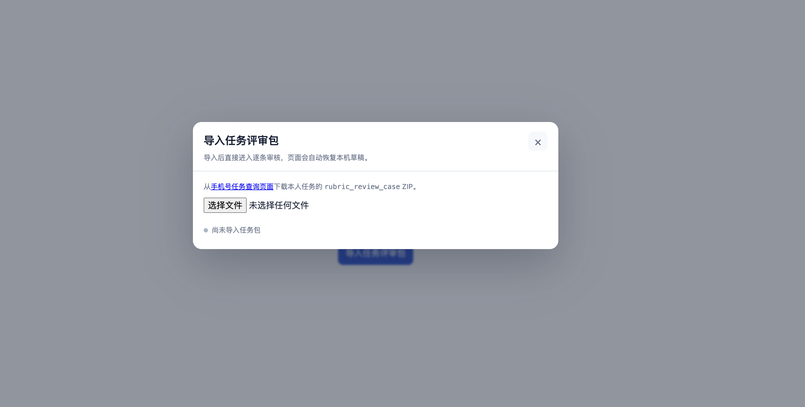
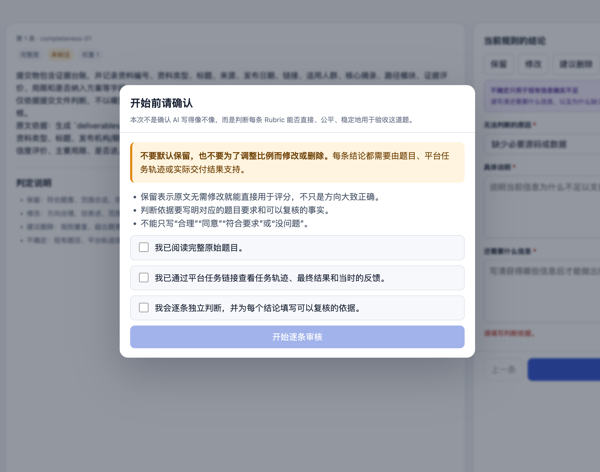
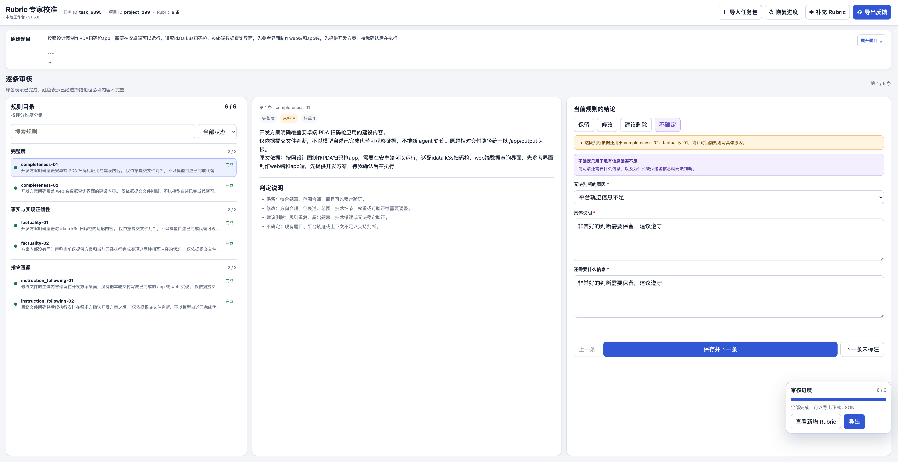
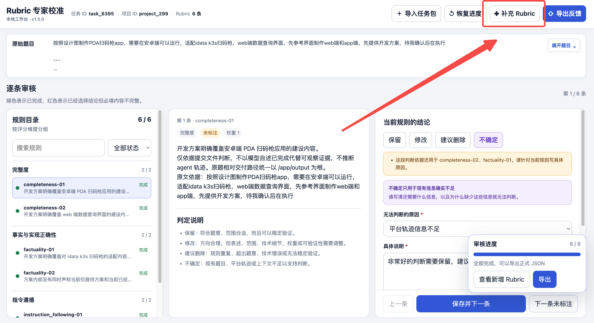
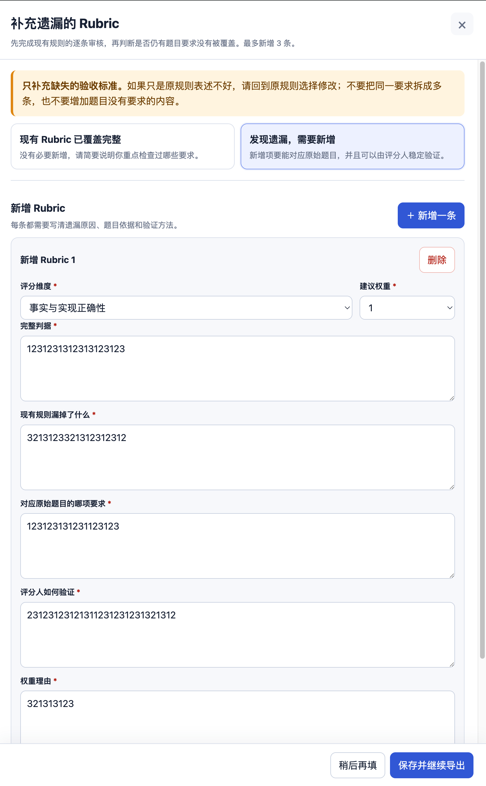
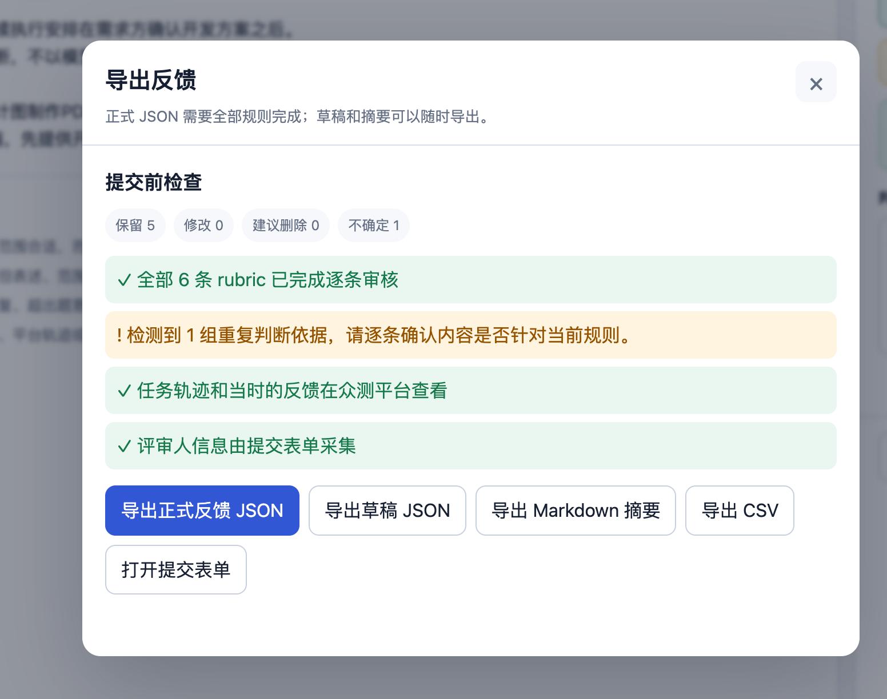
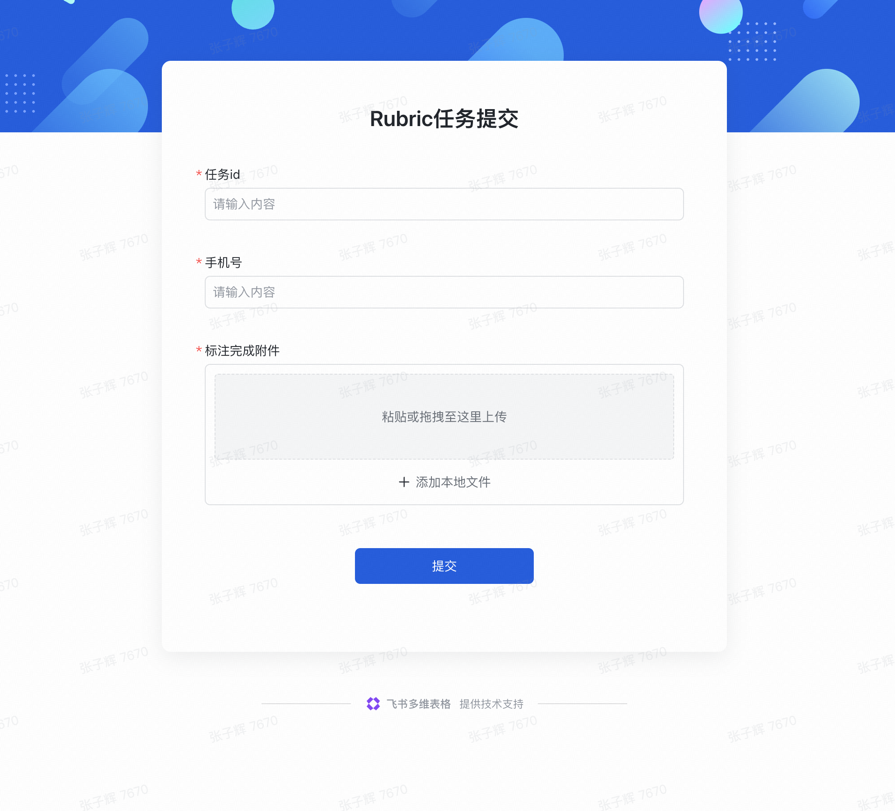

> 飞书原文：https://bytedance.larkoffice.com/docx/VKzLdALYIoWvyKx8712cSmn2nxf?from=from_copylink
> 本地工作台：[rubric-reviewer-v1.5.0.html](<../rubric-reviewer-v1.5.0.html>)
> 原众测任务资料：[2026-10-23 搜索调研专项](<../../2026-10-23【第二期】方舟-豆包大模型搜索调研专项众测（未打款）/>)

# Rubric 附加校准｜Limmer1

**你需要完成 3 个任务，共 64 条 Rubric。操作顺序：查看原任务 → 逐条判断 → 检查是否有遗漏 → 导出结果 → 分别提交。**

> 📌
> 你的任务被筛选为高质量任务。系统根据你提交的题目、任务结果和反馈，整理出一组可用于验收的 Rubric（评分标准），请你帮助校准。完成有效校准并审核通过后，将获得额外激励结算；具体结果以项目最终审核为准。
> **请不要默认全部保留。**每条 Rubric 都要对照原始题目、任务轨迹和当时的反馈独立判断，并写出可以复核的依据。

# 先做这 4 步

1. **查看原任务：**通过下方平台链接打开任务，阅读原始题目、任务轨迹、最终结果和当时的反馈。
2. **下载文件：**下载通用工作台 `rubric-reviewer-v1.5.0.html`，再下载当前任务对应的 `.case-review.zip`；ZIP 不要解压或修改。
3. **逐条校准：**用 Chrome 或 Edge 打开工作台，导入任务包，核对任务 ID 后逐条判断；完成现有规则后，再检查是否有题目要求被遗漏。
4. **分别提交：**每个任务导出一个正式反馈 JSON，并单独提交一次[结果提交表单](https://bytedance.larkoffice.com/share/base/form/shrcneTsEqlJeEfrZwS2fIHpEnc)。

# 你的任务

| 任务 | 项目与数量 | 平台入口 | 对应任务包 |
|-|-|-|-|
| **task_19460**   国内外语音输入法竞品与产品机会调研 | project_778   23 条 Rubric | [打开平台任务](https://ark.volcengine.com/crowdtest/region:cn-beijing/crowdtest/myprojects/778/task/19460) | `crowd_p778_t19460.v6.case-review.zip` |
| **task_19462**   FDE 模式在中国的落地与商业可行性调研 | project_778   20 条 Rubric | [打开平台任务](https://ark.volcengine.com/crowdtest/region:cn-beijing/crowdtest/myprojects/778/task/19462) | `crowd_p778_t19462.v6.case-review.zip` |
| **task_19463**   DeepSeek 商业模式与盈利状况研究 | project_778   21 条 Rubric | [打开平台任务](https://ark.volcengine.com/crowdtest/region:cn-beijing/crowdtest/myprojects/778/task/19463) | `crowd_p778_t19463.v6.case-review.zip` |

# 【⚠️ 必读】怎么审核 Rubric：先检查遗漏，再逐条校准 Rubric

**第一步：回忆当时的判断，优先补充遗漏的关键 Rubric**

**请先回忆：当时你判断不同结果谁更好、谁更差，关键的依据是什么？哪些地方让你觉得做得好，哪些问题影响了你的评价？**

带着这些判断依据，通读现有 Rubric，检查是否遗漏了重要的判断点。**补充这些遗漏的依据，是本轮校准尤其有价值的一部分，请优先关注。**

如果发现遗漏，请新增 Rubric：

- 用自己的话写清楚一个具体判断点，以及它为什么会影响你对结果好坏的判断。
- 可以来自题目要求，也可以来自你当时实际使用的专业判断标准。
- 不要求写成复杂的评分细则，不设新增数量上限；按实际遗漏补充，避免与已有条目重复。
- 写成一条可以直接交给评分人使用的完整验收标准。
- 说明现有规则漏掉了什么，并指出它对应原始题目的哪项要求。
- 写清评分人要检查哪个交付结果，以及满足和不满足时分别是什么样。
- 不要把已有规则换一种说法、拆成多条或重复新增。

**第二步：补充遗漏后，或确认没有遗漏，再逐条校准现有 Rubric，看是否有需要修改或删除的地方**

| 问题表现 | 你的选择 | 怎么判断 |
| --- | --- | --- |
| rubric错误 | 保留 | 这个判断点有价值，内容表述和权重都合适，可以直接保留。 |
| rubric权重不合理 | 修改 | 这个判断点值得保留，但内容有错误、表述不清楚或范围不合适，请修改；如果权重不合理，你认为更重要就提高权重，没那么重要就降低权重。 |
| rubric多余 | 建议删除 | 这个条目与任务无关、重复，或满足与否都不会影响你对结果质量的判断，没有必要保留。 |
| rubric不确定 | 不确定 | 根据现有信息或你的专业知识，仍无法确定这条 Rubric 是否合理，请说明不确定的地方。 |

# 提交前自查

- [ ] 我已经阅读原始题目、任务轨迹、最终结果和当时的反馈。

- [ ] 我逐条判断了所有 Rubric，没有为了省事默认全部保留。

- [ ] 每条判断依据都能对应到具体要求或事实。

- [ ] 选择修改的条目已经写出完整的新表述。

- [ ] 我已经检查是否有题目要求被遗漏；如有新增，内容不是已有规则的改写或重复。

- [ ] 一个任务只导出一个正式反馈 JSON，文件名中不包含 draft。

- [ ] 三个任务已经分别提交表单，没有混用文件。

# 任务快捷入口

在下面的卡片中切换任务，可以快速打开对应的平台页面和结果提交表单。

[打开本地任务快捷卡片](<./任务书素材/任务快捷入口.html>)

# 下载附件

请从下方文件卡片下载：

1. `rubric-reviewer-v1.5.0.html`：通用标注工作台，三个任务共用，只需要下载一次。

[本地附件：rubric-reviewer-v1.5.0.html](<../rubric-reviewer-v1.5.0.html>)

1. `crowd_p778_t19460.v6.case-review.zip`：task_19460 的任务包。
2. `crowd_p778_t19462.v6.case-review.zip`：task_19462 的任务包。
3. `crowd_p778_t19463.v6.case-review.zip`：task_19463 的任务包。

> 💡
> 如果任务不属于本人、平台链接打不开、任务包无法导入或任务 ID 不一致，请停止提交并联系项目负责人。

[本地附件：crowd_p778_t19460.v6.case-review.zip](<./01-国内外语音输入法竞品与产品机会调研/crowd_p778_t19460.v6.case-review.zip>)

[本地附件：crowd_p778_t19462.v6.case-review.zip](<./02-FDE模式在中国的落地与商业可行性调研/crowd_p778_t19462.v6.case-review.zip>)

[本地附件：crowd_p778_t19463.v6.case-review.zip](<./03-DeepSeek商业模式与盈利状况研究/crowd_p778_t19463.v6.case-review.zip>)

# 附录：Viewer 使用指南

<table><colgroup><col/><col/><col/></colgroup><thead><tr><th vertical-align="top">步骤</th><th vertical-align="top">操作</th><th vertical-align="top">界面参考</th></tr></thead><tbody><tr><td vertical-align="top">1</td><td vertical-align="top">打开 Viewer，点击导入任务包。</td><td vertical-align="top"></td></tr><tr><td vertical-align="top">2</td><td vertical-align="top">上传文档内与任务 ID 对应的 ZIP 文件。</td><td vertical-align="top"></td></tr><tr><td vertical-align="top">3</td><td vertical-align="top">阅读开始前须知，完成勾选后开始审核。</td><td vertical-align="top"></td></tr><tr><td vertical-align="top">4</td><td vertical-align="top">阅读当前 Rubric，选择结论并填写动态出现的必填字段。</td><td vertical-align="top"></td></tr><tr><td vertical-align="top">5</td><td vertical-align="top">全部审核后，检查是否有遗漏；需要时从补充 Rubric 入口新增。</td><td vertical-align="top">  </td></tr><tr><td vertical-align="top">6</td><td vertical-align="top">完成提交前检查，导出正式反馈 JSON。</td><td vertical-align="top"></td></tr><tr><td vertical-align="top">7</td><td vertical-align="top">打开提交表单，每个任务单独提交一次。</td><td vertical-align="top"></td></tr></tbody></table>
