> 飞书原文：https://bytedance.larkoffice.com/wiki/EMQbwH8kGiDkIXk6S4EcjonfnKd
> 本地工作台：[rubric-reviewer-v1.5.0.html](<../rubric-reviewer-v1.5.0.html>)
> 原众测任务资料：[2026-10-23 搜索调研专项](<../../2026-10-23【第二期】方舟-豆包大模型搜索调研专项众测（未打款）/>)

# 【第二期】方舟-豆包大模型高质量Rubric激励专项

> 🏆
> 欢迎参与本期方舟高质量开发者Rubric激励专项。
> 需要您基于历史任务生成的Rubric给出质量评估，我们将基于您的评估质量给予一定奖励，您也可通过新增高质量的Rubric获得额外激励。

# 一、任务概览

| **测评对象** | **历史任务的Rubric反馈** |
|-|-|
| **测评截止时间** | 2026年11月2日 12:00 |
| **任务数量** | 基于文档中特定个数的任务，每个任务均需完成全部Rubric的测试与评分；   可新增Rubric，质检识别为高质量的Rubric会获得额外激励 |
| **预计投入** | 整体约2-3个小时 |
| **任务目标** | 提交有依据、有区分度的Rubric质量评价。 |

## 任务概述

1. **获取任务书**：打开[**查询页**](https://bytedance.larkoffice.com/share/base/query/shrcnuhNJt4c35pbd5EMPA1wNIb)，找到项目id为输入您在众测平台绑定的手机号获取专属任务书**（您需要申请文档权限）**

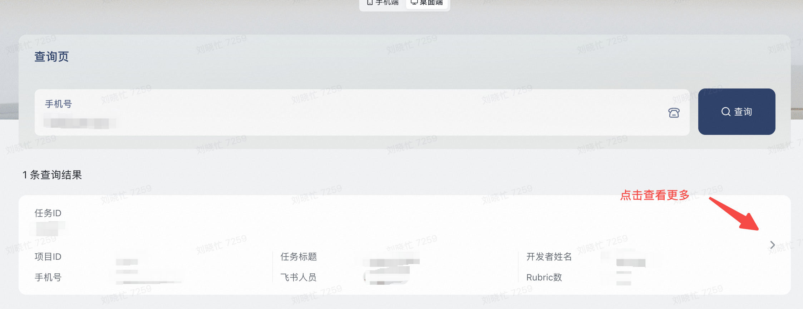

1. **查看任务文档**：在任务文档中获取任务的平台入口与对应任务包，完成必要的自查
2. **完成评测任务：**进入任务入口、下载附件，进行Rubric的质量评价

## 费用与结算标准

> 💡
> **费用结算说明：**
> - **新增ruburic：20元/条**
> - **修改/删除ruburic：10元/条**
> - **保留rubric：5元/条**
> - **不确定是否保留或删除：2元/条**
> 未完成任务、Rubric的反馈质检不合格情形，均不予结算。
> 触犯硬性红线按 0 元处理，并取消后续参与资格。

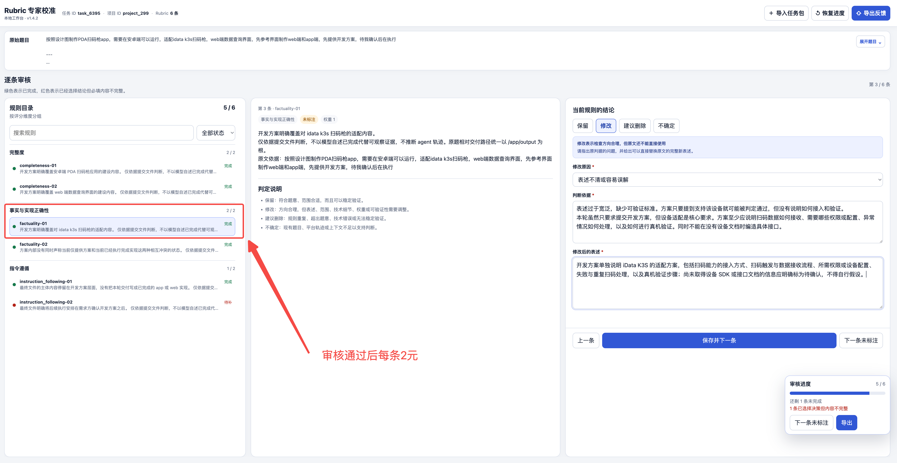

## 【⚠️ 必读】怎么审核 Rubric：先检查遗漏，再逐条校准 Rubric

**第一步：回忆当时的判断，优先补充遗漏的关键 Rubric**

**请先回忆：当时你判断不同结果谁更好、谁更差，关键的依据是什么？哪些地方让你觉得做得好，哪些问题影响了你的评价？**

带着这些判断依据，通读现有 Rubric，检查是否遗漏了重要的判断点。**补充这些遗漏的依据，是本轮校准尤其有价值的一部分，请优先关注。**

如果发现遗漏，请新增 Rubric：

- 用自己的话写清楚一个具体判断点，以及它为什么会影响你对结果好坏的判断。
- 可以来自题目要求，也可以来自你当时实际使用的专业判断标准。
- 不要求写成复杂的评分细则，不设新增数量上限；按实际遗漏补充，避免与已有条目重复。
- 写成一条可以直接交给评分人使用的完整验收标准。
- 说明现有规则漏掉了什么，并指出它对应原始题目的哪项要求。
- 写清评分人要检查哪个交付结果，以及满足和不满足时分别是什么样。
- 不要把已有规则换一种说法、拆成多条或重复新增。

**第二步：补充遗漏后，或确认没有遗漏，再逐条校准现有 Rubric，看是否有需要修改或删除的地方**

| 问题表现 | 你的选择 | 怎么判断 |
| --- | --- | --- |
| rubric错误 | 保留 | 这个判断点有价值，内容表述和权重都合适，可以直接保留。 |
| rubric权重不合理 | 修改 | 这个判断点值得保留，但内容有错误、表述不清楚或范围不合适，请修改；如果权重不合理，你认为更重要就提高权重，没那么重要就降低权重。 |
| rubric多余 | 建议删除 | 这个条目与任务无关、重复，或满足与否都不会影响你对结果质量的判断，没有必要保留。 |
| rubric不确定 | 不确定 | 根据现有信息或你的专业知识，仍无法确定这条 Rubric 是否合理，请说明不确定的地方。 |

# 二、评分与质检

## 每条 Rubric 怎么判断

| 你的选择 | 什么时候选 | 必须填写 |
|-|-|-|
| **保留** | 原表述不改字就能直接用于评分，范围和要求都准确 | 写清对应的题目要求和可复核事实 |
| **修改** | 方向合理，但表述、范围、技术细节、权重或可验证性需要调整 | 修改原因、判断依据、可以直接替换原文的完整新表述 |
| **建议删除** | 与题目无关、重复、错误、无法验证，或不必要地限制实现方式 | 删除原因和判断依据 |
| **不确定** | 现有题目、轨迹或反馈不足以判断 | 缺少什么信息，以及为什么缺少后无法判断 |

## 提交前自查

- [ ] 我已经阅读原始题目、任务轨迹、最终结果和当时的反馈。

- [ ] 我逐条判断了所有 Rubric，没有为了省事默认全部保留。

- [ ] 每条判断依据都能对应到具体要求或事实。

- [ ] 选择修改的条目已经写出完整的新表述。

- [ ] 一个任务只导出一个正式反馈 JSON，文件名中不包含 `draft`。

- [ ] 两个任务已经分别提交表单，没有混用文件。

## 高质量Rubric标注长什么样

| **脱敏案例** | **决策** | **原始判据** | **原因分类** | **高质量判断依据** | **修改后表述／所需信息** |
|-|-|-|-|-|-|
| 案例 A：上市公司董监高信息抽取 | **保留** | 变动明细至少包含并实际填充9个字段：序号、报告期、姓名、类别、职务、变动类型、变动日期、变动原因、来源文件。 | 与题目直接对应、可稳定验证 | 题目明确列出了这9个字段。本条没有增加额外要求，可以直接检查工作簿或CSV的列名和实际数据，不依赖主观判断。 | 无需修改。 |
| 案例 B：实验运行 CLI 改造 | **保留** | resume 从最后一个有效检查点继续，恢复必要状态，已完成且校验通过的阶段不得重复执行。 | 核心要求、验收方法明确 | 题目明确要求恢复不能从头重跑，也不能直接把状态改成成功。可以通过中断进程、执行恢复命令、比较阶段计数和最终产物进行验证。 | 无需修改。 |
| 案例 A：上市公司董监高信息抽取 | **修改** | 最终数据必须包含历任现任明细表，按年度列出人员、职务、任期起止和任职状态。 | 将可选要求写成强制要求 | 题目原文是能提取则提供。若原报告缺少相关信息，但提交物已经说明原因，不应直接判定为不完整。 | 如果年度报告能够可靠提取现任人员信息，则提供历任现任明细表；无法完整提取时，应列出受影响报告、缺失字段和原因，不得静默省略。 |
| 案例 A：上市公司董监高信息抽取 | **修改** | 必须建立逐报告原始披露层；同一事件在半年报和年报重复出现时，原始层仍分别保留。 | 不必要地限定数据组织方式 | 题目要求去重并保证结果可追溯，但没有规定必须单独建立原始披露层。来源列表、重复披露次数等方式也可以满足复核要求。 | 去重后的每条最终事件必须保留全部来源报告或重复披露记录；可以通过独立原始表、来源列表或重复次数实现，不限定固定表结构。 |
| 案例 C：行业运营方法研究 | **建议删除** | 除最低要求外，还必须提供结构化来源总台账，记录来源编号、机构、标题、URL、日期和证据等级。 | 超出题目要求 | 题目只要求关键数据标注来源，并对部分引用链接进行验证，没有要求额外建立来源总台账或划分证据等级。原判据自身也写明这是最低要求之外的增强项。 | 建议删除，不作为必选评分项；如需要，可作为不计分的优秀实践。 |
| 案例 C：行业运营方法研究 | **建议删除** | 必须提供自动化质量检查或可复现构建脚本，用于重新生成HTML/PDF并检查章节完整性。 | 增加未要求的工程交付物 | 题目要求交付报告、可视化版本和链接验证结果，没有要求提供构建程序。缺少脚本不影响报告内容的验收。 | 建议删除；不能因为没有自动化构建脚本而降低符合题意的报告得分。 |
| 案例 A：上市公司董监高信息抽取 | 不确定 | 逐报告原始层的变动事件合计为 N 条，并排除无变动占位行和部分正文补充记录。 | 缺少原始数据，无法核验精确数字 | 题面只说明需要处理若干年度报告，没有给出事件总数。该数字应当由原始报告计算得出，不能仅根据生成的 Rubric 判断。 | 需要逐份读取原始报告，记录各报告条目数，并明确占位行、正文事项和表格事件的统计口径。 |
| 案例 A：上市公司董监高信息抽取 | 不确定 | 最新在职名单为 N 人，包括人员 A、人员 B等；人员 M、人员 N 应为已离任。 | 缺少报告附件和状态截止口径 | 人员名单没有直接出现在题面中，需要结合最新年报、变动表和期后任免事项判断。如果无法访问原始报告，就不能确认名单是否准确。 | 需要最新年度报告、期后任免事项，以及状态截止日期；核对后再决定保留、修改或删除。 |

# 三、参与步骤

## 第一步：进入任务入口，**查看原任务 → 逐条判断 → 导出结果 → 分别提交**

在下面的卡片中切换任务，可以快速打开对应的平台页面和结果提交表单。

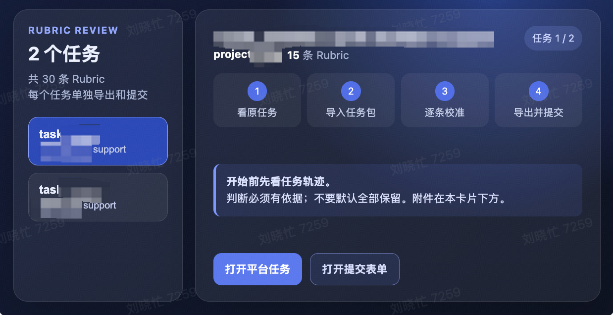

## 第二步：下载附件

请从下方文件卡片下载：`rubric-reviewer-v1.5.0html`：通用标注工作台，所有任务共用，只需要下载一次。

[本地附件：rubric-reviewer-v1.5.0.html](<../rubric-reviewer-v1.5.0.html>)

## 第三步：基于您的任务，使用viewer对Rubric进行打分

<table><colgroup><col/><col/><col/></colgroup><thead><tr><th>步骤</th><th>操作</th><th>截图</th></tr></thead><tbody><tr><td>1</td><td>打开Viewer</td><td></td></tr><tr><td>2</td><td>导入任务评审包 上传文档内的任务包zip压缩文件</td><td>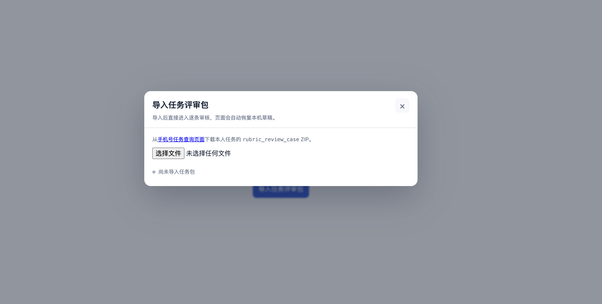</td></tr><tr><td>3</td><td>确认须知 勾选后点击开始</td><td>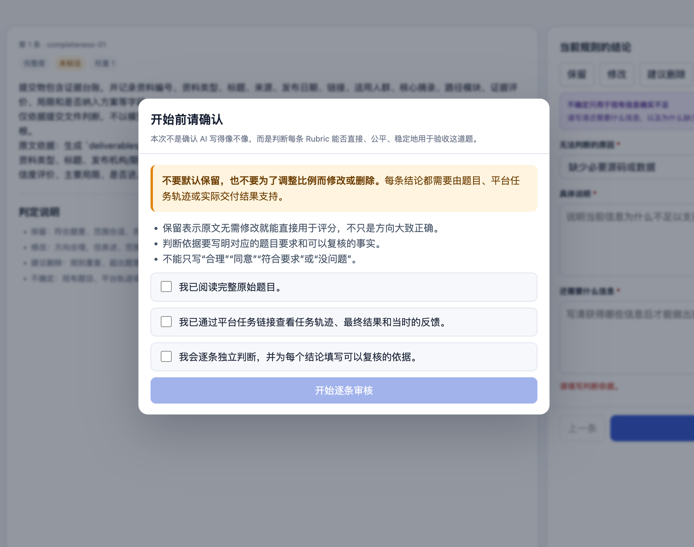</td></tr><tr><td>4</td><td>阅读rubric 选择意见，填写对应意见下的字段</td><td>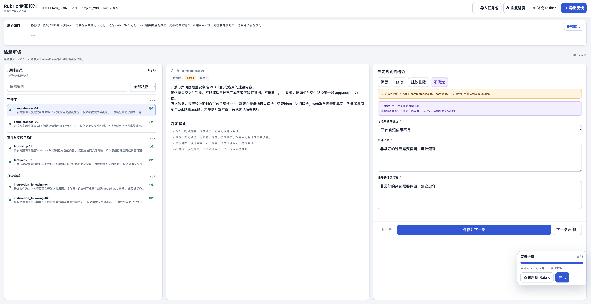 不同选项下内容：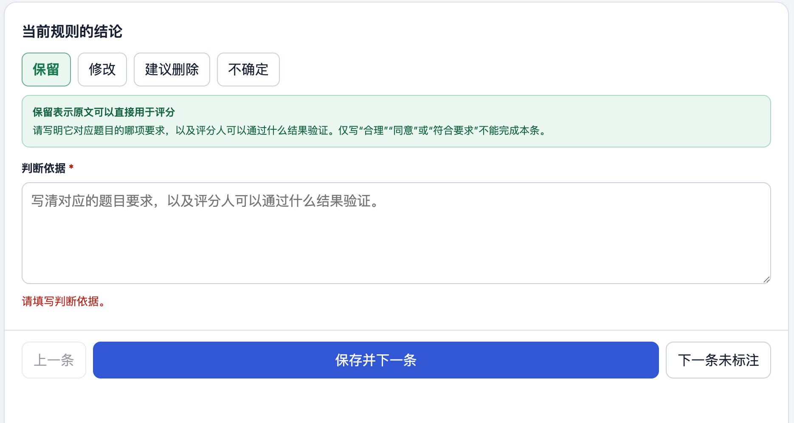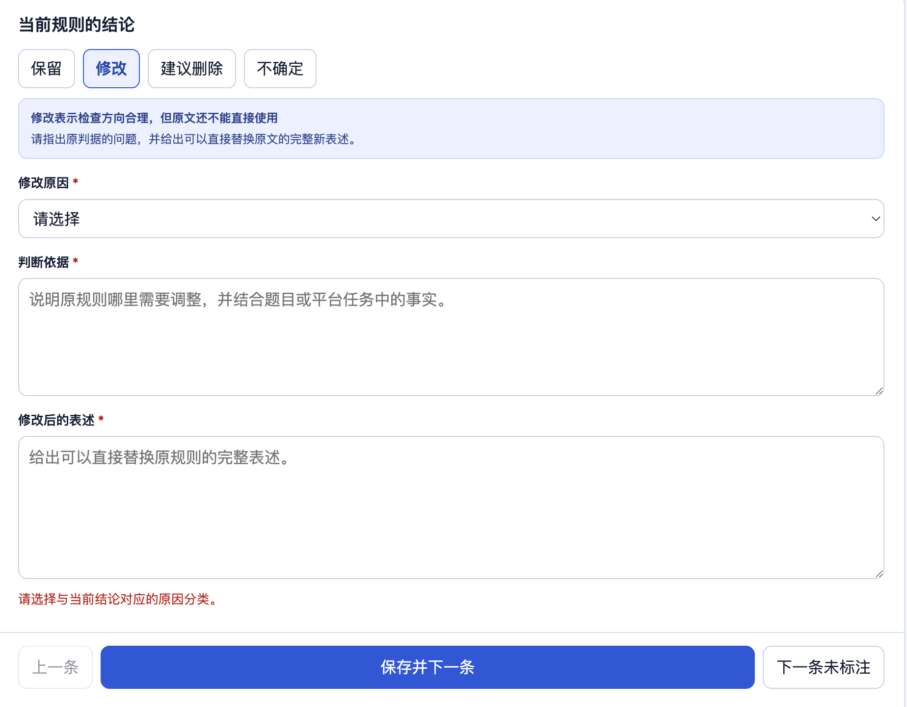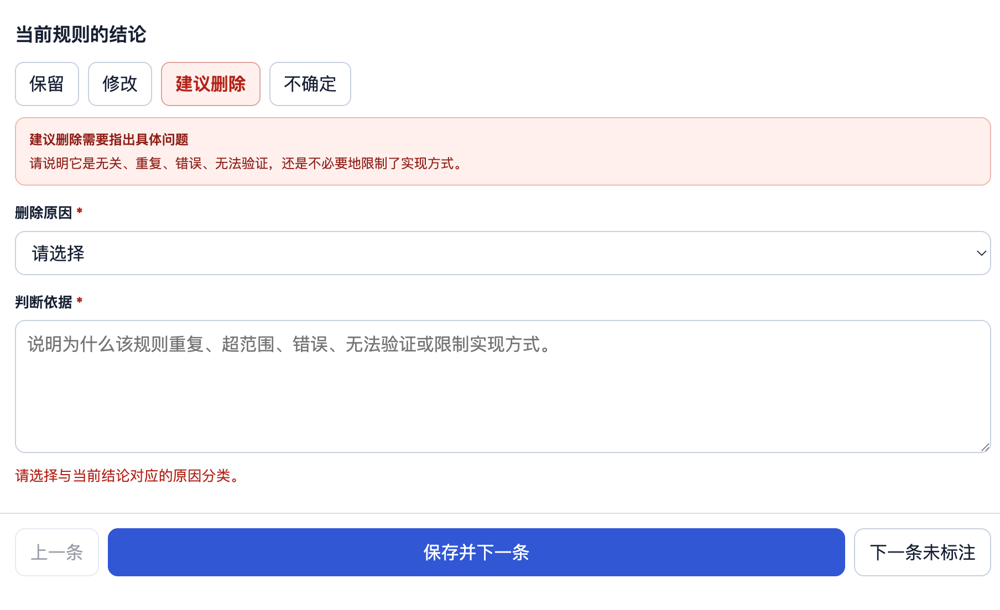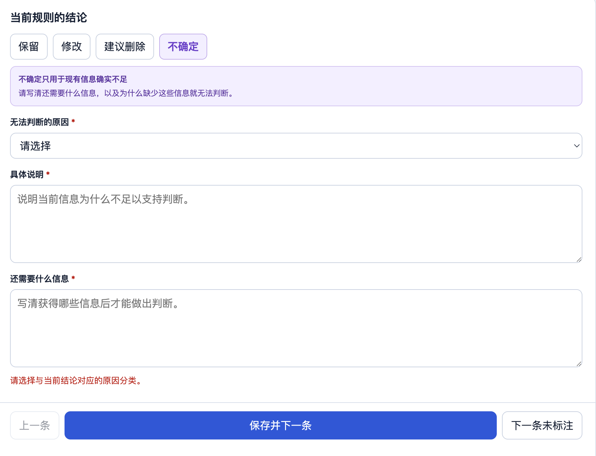</td></tr><tr><td>5</td><td>保存所有反馈标注后，阅读事项并检查</td><td>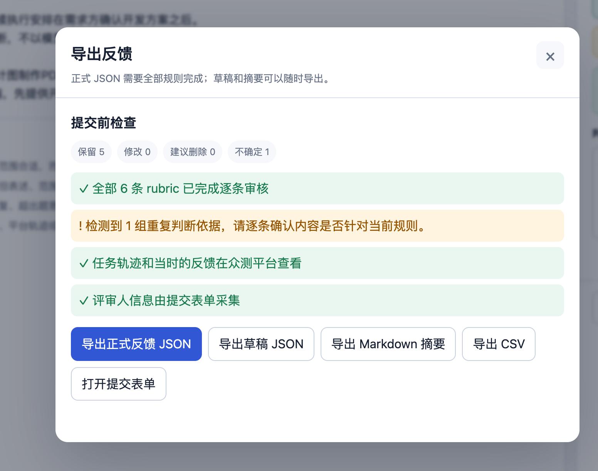</td></tr><tr><td>6</td><td>导出正式反馈Json</td><td>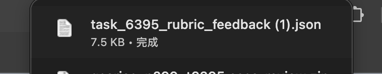</td></tr></tbody></table>

## 第四步：提交[**多维表单**](https://bytedance.larkoffice.com/share/base/form/shrcneTsEqlJeEfrZwS2fIHpEnc)，每个任务提交一个：[Rubric任务提交](https://bytedance.larkoffice.com/share/base/form/shrcneTsEqlJeEfrZwS2fIHpEnc)

<table><colgroup><col/><col/></colgroup><tbody><tr><td>提交多维表表单 每个任务提交1个</td><td><a href="https://bytedance.larkoffice.com/share/base/form/shrcneTsEqlJeEfrZwS2fIHpEnc?iframeFrom=docx&amp;ccm_open=iframe">打开在线表单</a></td></tr></tbody></table>

## 第五步（选填）：新增Rubric

<table><colgroup><col/></colgroup><tbody><tr><td>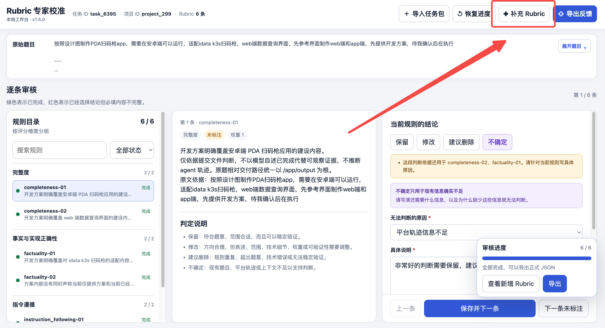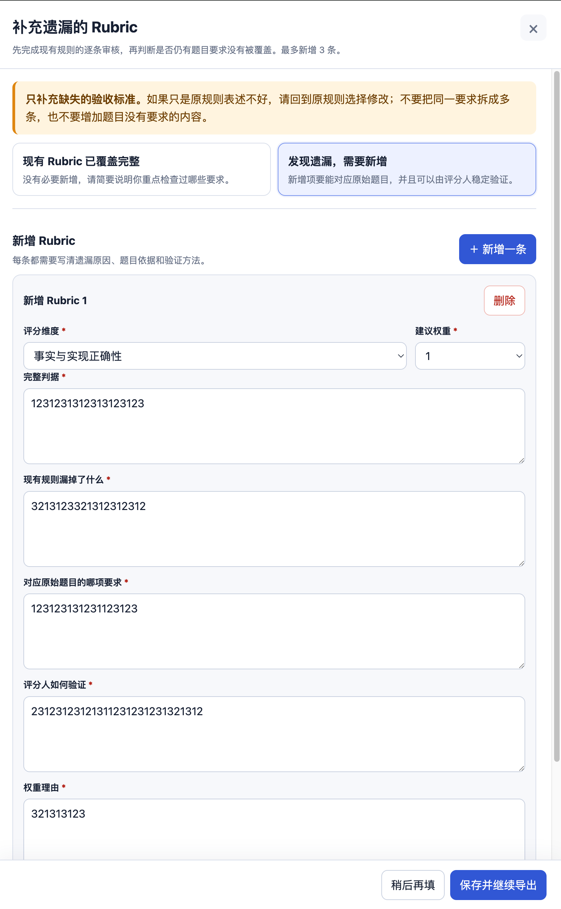</td></tr></tbody></table>
